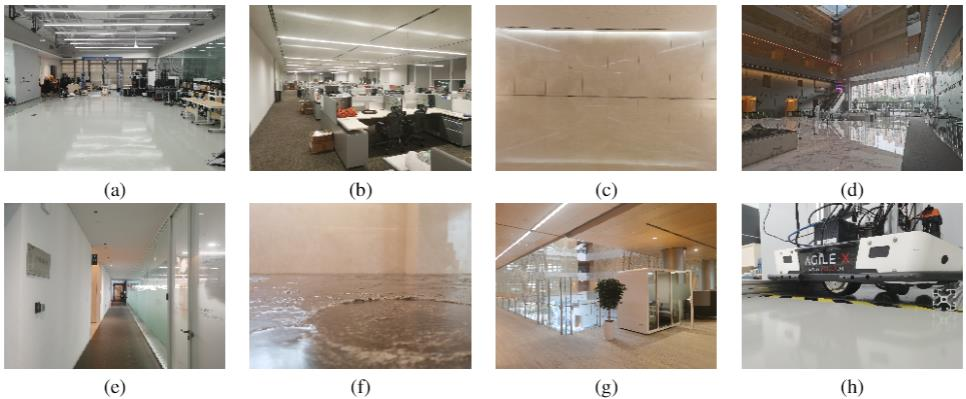
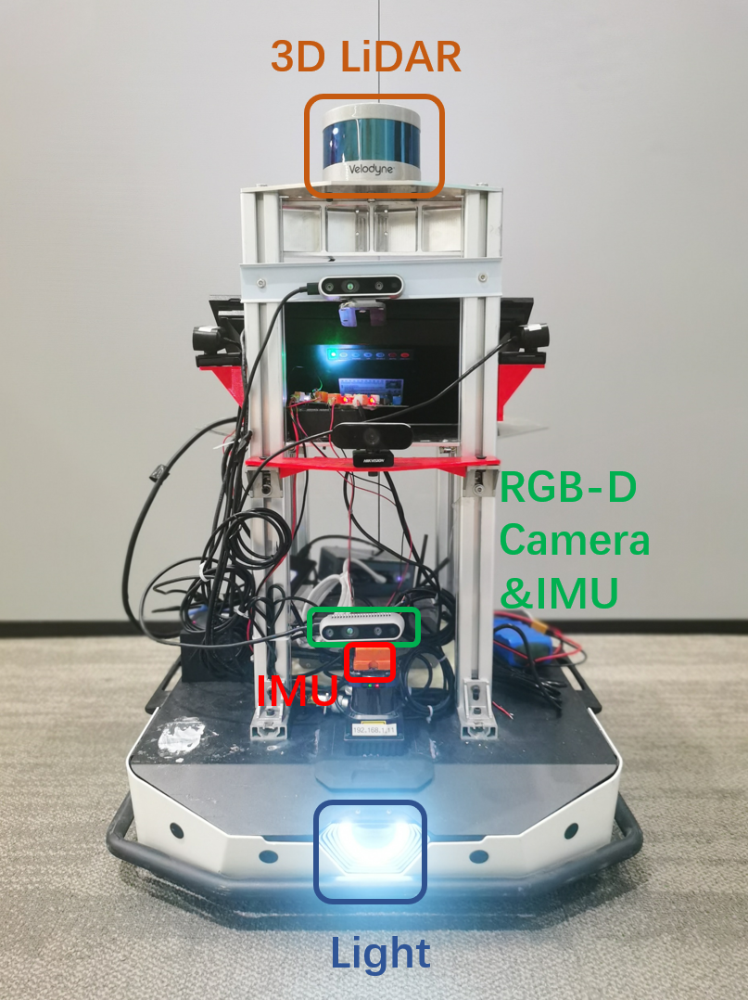

# 	Ground-Challenge
## A Multi-sensor SLAM Dataset	Focusing on Corner Cases for Ground Robots

   

   

Figure 1. Different corner cases for SLAM

# 🎯 Notice
## 2026.10.22: Old download links are not working, I'm uploading these bags to a new onedrive account and will fix this problem as soon as possible!

## Notice: 
### We strongly recommend that the newly proposed SLAM algorithm be tested on our Ground-Challenge benchmark, because our data has following features:

1. A rich pool of sensory information including RGBD, wheel, IMU and so on.
   
2. This benchmark includes diverse corner cases such as aggressive motion, severe occlusion, changing illumination, few textures, pure rotation, motion blur, wheel suspension, etc.

  
3. This benchmark brings great challenge to existing cutting-edge SLAM algorithms including VINS-Mono, [ORB-SLAM3](https://github.com/UZ-SLAMLab/ORB_SLAM3), [VINS-RGBD](https://github.com/STAR-Center/VINS-RGBD), [VIW-Fusion](https://github.com/TouchDeeper/VIW-Fusion) and [TartanVO](https://github.com/castacks/tartanvo). If your proposed algorihm outperforms SOTA systems on this dataset, your paper will be much more convincing and valuable.

## License

The paper link is [here](https://arxiv.org/abs/2307.03890).If you use Ground-Challenge in an academic work, please cite:
~~~
@inproceedings{yin2023ground,
  title={Ground-challenge: A multi-sensor slam dataset focusing on corner cases for ground robots},
  author={Yin, Jie and Yin, Hao and Liang, Conghui and Jiang, Haitao and Zhang, Zhengyou},
  booktitle={2023 IEEE International Conference on Robotics and Biomimetics (ROBIO)},
  pages={1--5},
  year={2023},
  organization={IEEE}
}
~~~

## ABSTRACT:

We introduce Ground-Challenge: a novel dataset collected by a ground robot with multiple sensors including an RGB-D camera, an inertial measurement unit (IMU), a wheel odometer and a 3D LiDAR to support the research on corner cases of visual SLAM systems.
Our dataset comprises 36 trajectories with diverse corner cases such as aggressive motion, severe occlusion, changing illumination, few textures, pure rotation, motion blur, wheel suspension, etc. Some state-of-the-art SLAM algorithms are tested on our dataset, showing that these systems are seriously drifting and even failing on specific sequences.
We will release the dataset and relevant materials upon paper publication to benefit the research community.

## 1.SENSOR SETUP
### 1.1 Acquisition Platform
The ground robot is given below. The unit of the figures is centimeter.

Figure 2. The data capture robot.

### 1.2 Sensor parameters

All the sensors and track devices and their most important parameters are listed as below:

* **LIDAR** Velodyne VLP-16, 360 Horizontal Field of View (FOV),-30 to +10 vertical FOV,10Hz,Max Range 200 m,Range Resolution 3 cm, Horizontal Angular Resolution 0.2°.  

* **V-I Sensor**,Realsense d435i,RGB/Depth 640*480,69H-FOV,42.5V-FOV,15Hz;IMU 6-axix, 200Hz  
* **IMU**,Xsens Mti-300,9-axis,400Hz;  
* **Wheel Odometer**,AgileX,2D,25Hz;  

The rostopics of our rosbag sequences are listed as follows:

* LIDAR: `/velodyne_points` 

* V-I Sensor:  
`/camera/color/image_raw `,  
`/camera/depth/image_raw `,  
`/camera/imu`

* IMU: `/imu/data `
 
* Wheel Odometer: `/odom `

## 2.DATASET SEQUENCES

> **OneDrive folder:** [Browse all rosbags](https://1drv.ms/f/c/3e825cd7abd6dff7/IgBuFgfBxC8YTIaWp725ix-JAfT8JU6fpqAp_n13fTWwLrk)
>
> Individual download links below point to specific `.bag` files.

> [!TIP]
>  We are delighted to see that many users enjoy our Ground-Challenge dataset. However, **due to an overwhelming number of download requests, OneDrive has become unstable. If you encounter any issues, please wait for about 10 minutes and try again.**

An overview of Ground-Challenge is given in the table below:
Scenario|Darkroom|Occlusion|Office|Room|Wall|Motionblur|Hall|Loop|Roughroad|Corridor|Rotation|Static|Slope|TOTAL
--|:--|:--:|--:|--:|--:|--:|--:|--:|--:|--:|--:|--:|--:|--:
Number |3|4|3|3|3|3|3|2|3|2|3|2|2|36
Dist/m |92.0|273.8|75.5|102.1|86.7|166.6|236.3|371.8|68.1|164.3|12.4|1.9|128.5|1780.0
Duration/s |203.6|334.2|164.0|154.7|189.3|145.5|302.4|332.7|186.3|198.1|183.2|92.6|195.0|2681.6
Size/GB|6.1|9.9|4.7|4.6|5.6|4.3|8.7|9.9|5.4|5.8|5.4|2.7|5.7|78.8

### 2.1 Visual Challenges

  

  
  
Sequence Name|Total Size|Duration|Features|Rosbag
--|:--|:--:|--:|--:
Darkroom1|2.9g|100s|slight light, going into a room|[Rosbag](https://1drv.ms/u/c/3e825cd7abd6dff7/IQC2MTfIbAONRaGy71QIgsooAfhjWWnh4Q3boOtnyiRCUlo)
Darkroom2|2.3g|76s|sharp turn|[Rosbag](https://1drv.ms/u/c/3e825cd7abd6dff7/IQAIEKMFqFTtQKCJXQYpB5OMAazpuqVW_NdHaQUt6rHU69c)
Darkroom3|1.9g|64s|slight light|[Rosbag](https://1drv.ms/u/c/3e825cd7abd6dff7/IQAfDJWhS7SxTYVxsQaS-kfOAZS2nHWCD-_o6n1A8T6jHMg)
Occlusion1|2.9g|97s|moving feet, far features|[Rosbag](https://1drv.ms/u/c/3e825cd7abd6dff7/IQBjRY3c9IVYTLs5rSfpyz5kAaddxsMAMrQEgenSsJvipbA)
Occlusion2|3.2g|108s|hand occlusion|[Rosbag](https://1drv.ms/u/c/3e825cd7abd6dff7/IQC_Vo0XSGjgTKX6EfOS_PfCAVUJ4Uq6DnEvzh7BCWRbGDU)
Occlusion3|2.6g|89s|hand occlusion|[Rosbag](https://1drv.ms/u/c/3e825cd7abd6dff7/IQBStx3KDTQlR7A7v7tKntRiAWqEPF76NrC4SDfo13WsHiU)
Occlusion4|1.2g|40s|complete occlusion|[Rosbag](https://1drv.ms/u/c/3e825cd7abd6dff7/IQDUr9DIrBuSSpg9zPOv9RxSARhg-6Cp0Arnz3__ejiGQMA)
Office1|1.3g|46s|exposure change|[Rosbag](https://1drv.ms/u/c/3e825cd7abd6dff7/IQDW3RxVKWXOTpgLT7ktemmOAbKu9G8LamGbszjbqaaDBNE)
Office2|1.9g|66s|going into a dark room|[Rosbag](https://1drv.ms/u/c/3e825cd7abd6dff7/IQAleR-j9HRFQo3h7Fm54g3OAU5NiUmbmwPJzKR7ri0LKuw)
Office3|1.5g|52s|office|[Rosbag](https://1drv.ms/u/c/3e825cd7abd6dff7/IQDMBdp0LkpiSY4y2UjxJQuJARJGH09ZzcQr3SgneV5Z_hg)
Room1|1.3g|46s|exposure change|[Rosbag](https://1drv.ms/u/c/3e825cd7abd6dff7/IQAd9JwOGGjHTYDni0WA6hKzAa1x_MLUmVtWS9hzx9NoT4Y)
Room2|1.9g|66s|going into a dark room|[Rosbag](https://1drv.ms/u/c/3e825cd7abd6dff7/IQAmNtOLZ39wS6B5CRWFP2l2AWXjk1Fr3E4cPhoLirPflao)
Room3|1.5g|52s|office|[Rosbag](https://1drv.ms/u/c/3e825cd7abd6dff7/IQCsz4XIdmk1QYO0RCKpKa1uAVmoUQlF434IXq0CXR5AJoQ)
Motionblur1|1.5g|52s|aggressive motion|[Rosbag](https://1drv.ms/u/c/3e825cd7abd6dff7/IQCftiAFvxfDTKVUpV2W5aHtAZIkZmuv9ObPrqv-hcNY-nE)
Motionblur2|1.6g|54s|aggressive motion|[Rosbag](https://1drv.ms/u/c/3e825cd7abd6dff7/IQBMOdY529TuTJOcjTgYCY56ATRJA9IadYYm6MwsgQM_bfY)
Motionblur3|1.2g|40s|aggressive motion|[Rosbag](https://1drv.ms/u/c/3e825cd7abd6dff7/IQDQzIwB-OWzTrK4nhQde3vEAQcM65rEYgcO-yeZYCjF_ug)
Wall1|1.7g|59s|wall in a corridor|[Rosbag](https://1drv.ms/u/c/3e825cd7abd6dff7/IQDKve3xsYopQpKidMTIex4xAbDZgKPuZYzgPSOrK-OoR1E)
Wall2|2.0g|66s|wall in a big hall|[Rosbag](https://1drv.ms/u/c/3e825cd7abd6dff7/IQC89yOO642pQY5OT9doSr54AUmzeOc5_h6J0jgElde1dkw)
Wall3|3.9g|65s|wall in a corridor|[Rosbag](https://1drv.ms/u/c/3e825cd7abd6dff7/IQChYfWZh62FS4yqIr-Dh0bGAV-hwid4Q7GOwNwZgWckbeo)
  

  
### 2.2 Wheel Challenge

   

Sequence Name|Total Size|Duration|Features|Rosbag
--|:--|:--:|--:|--:
Hall1|2.6g|91s|slippery ground, a reflective surface|[Rosbag](https://1drv.ms/u/c/3e825cd7abd6dff7/IQD62M3UkWpCQqE77hpGZVIjAfbj0XRoFMB2DQ_cyMuksTQ)
Hall2|3.2g|110s|slippery ground, a reflective surface|[Rosbag](https://1drv.ms/u/c/3e825cd7abd6dff7/IQC-V6TdecllSYrstrd0Dth0ASepmzEpChCw1Hykzi1FRwA)
Hall3|2.9g|101s|slippery ground, walking human|[Rosbag](https://1drv.ms/u/c/3e825cd7abd6dff7/IQBHWsqGE7OYToAyl984TJLkAQ6DB3lYWZxaBjAFMyzyeKE)
Loop1|4.1g|97s|moving feet, far features|[Rosbag](https://1drv.ms/u/c/3e825cd7abd6dff7/IQDlRBxZj4wVRrM-44LWJ91iAdaLITGph_0LofkY_YlDnr4)
Loop2|5.8g|137s|hand occlusion|[Rosbag](https://1drv.ms/u/c/3e825cd7abd6dff7/IQBErkhiuVEWSrA8xUWrRPzKAe7jrD5zAmGnzXqwVMU8VFQ)
Roughroad1|2.2g|75s|rough road|[Rosbag](https://1drv.ms/u/c/3e825cd7abd6dff7/IQB2msNgCwkrQ7AORAx0r1cVAX4FD-t7rba83qk4wvnAMdI)
Roughroad2|1.5g|52s|rough road|[Rosbag](https://1drv.ms/u/c/3e825cd7abd6dff7/IQAzj-iyYwXuS7IHeWugC0LxAX14V8l50iTXOVskvTMBluU)
Roughroad3|1.8g|59s|rough road|[Rosbag](https://1drv.ms/u/c/3e825cd7abd6dff7/IQAyhpoEHXwnTpPcGGnPqqYTAfaHSGYA_wREaymkfHo7U-0)

  

  
### 2.3 Specific Movement Patterns
  

  
Sequence Name|Total Size|Duration|Features|Rosbag
--|:--|:--:|--:|--:
Corridor1|2.9g|100s|zigzag, long corridor|[Rosbag](https://1drv.ms/u/c/3e825cd7abd6dff7/IQDYxV-Cptc8QKUkZn9OtVzKAR9FHdXvnYZ6rdN77OPPJck)
Corridor2|2.9g|98s|straight forward, long corridor|[Rosbag](https://1drv.ms/u/c/3e825cd7abd6dff7/IQAl3XN5QSm5RpRpyHYIjSyCAQ6Qs9xXV1H34wg5TzEmSTU)
Rotation1|1.6g|53s|moving feet, far features|[Rosbag](https://1drv.ms/u/c/3e825cd7abd6dff7/IQD_lr84n-MeS6DVpPt5ZphUAQwEW_cGyfRK0gAz___zNJ4)
Rotation2|2.1g|73s|hand occlusion|[Rosbag](https://1drv.ms/u/c/3e825cd7abd6dff7/IQB9U46R3sPwQZEBvATnoDyzAc6AhKEt8FWDmEEoUwXKr6A)
Rotation3|1.7g|57s|rough road|[Rosbag](https://1drv.ms/u/c/3e825cd7abd6dff7/IQCwjFbYikUHQ4UQoECtsNPLAeHp3CnBsIb7QGvhnLEPlZA)
Static1|1.6g|56s|rough road|[Rosbag](https://1drv.ms/u/c/3e825cd7abd6dff7/IQD1ABndUkJbSo5Gyqj0eQwuAY_ZYHqyh7lQiXJUnXjpp-Y)
Static2|1.1g|37s|rough road|[Rosbag](https://1drv.ms/u/c/3e825cd7abd6dff7/IQCQL4uodEh4Q4HWKT_jg12JAaR-614CEUpa-hR4wZPRK3c)
Slope1|2.8g|96s|slope|[Rosbag](https://1drv.ms/u/c/3e825cd7abd6dff7/IQBVfM3W5dtkSKUBaLbnL6jYAZQnZjSwhzPJBA7q6J-vQsw)
Slope2|2.9g|99s|slope|[Rosbag](https://1drv.ms/u/c/3e825cd7abd6dff7/IQCE5GrE2LOuSpv3ULlUbADKAZ2xiQoAVn6Uv425vo7tXtI)

## 3. Configuration Files
We provide configuration files for several cutting-edge baseline methods, including [VINS-RGBD](https://github.com/sjtuyinjie/Ground-Challenge/tree/main/config_files_gc/vinsrgbd),[TartanVO](https://github.com/sjtuyinjie/Ground-Challenge/tree/main/config_files_gc/tartanvo),[VINS-Mono](https://github.com/sjtuyinjie/Ground-Challenge/tree/main/config_files_gc/vinsmono) and [VIW-Fusion](https://github.com/sjtuyinjie/Ground-Challenge/tree/main/config_files_gc/viwfusion).

## Star History

## Star History

<a href="https://www.star-history.com/?repos=sjtuyinjie%2FGround-Challenge&type=date&legend=top-left">
 <picture>
   <source media="(prefers-color-scheme: dark)" srcset="https://api.star-history.com/chart?repos=sjtuyinjie/Ground-Challenge&type=date&theme=dark&legend=top-left&sealed_token=yC7PbJZhYc2a2IWdLKleSUEflfGCPHJywSp9HH3dJgJb_BAuRUjjOrMslMOjooj1nWSDlzFfyoRP3eLF5y08wm2IB0JH_hRCAJNdOgFgGRpeuRA0-fjU5-ljHlLdVUtpOLNo0aWEgqVyrJHaSCAE3ZlstmzEdeeyurXVfnLbWCuknVW8Ef1XpsN7NLpe" />
   <source media="(prefers-color-scheme: light)" srcset="https://api.star-history.com/chart?repos=sjtuyinjie/Ground-Challenge&type=date&legend=top-left&sealed_token=yC7PbJZhYc2a2IWdLKleSUEflfGCPHJywSp9HH3dJgJb_BAuRUjjOrMslMOjooj1nWSDlzFfyoRP3eLF5y08wm2IB0JH_hRCAJNdOgFgGRpeuRA0-fjU5-ljHlLdVUtpOLNo0aWEgqVyrJHaSCAE3ZlstmzEdeeyurXVfnLbWCuknVW8Ef1XpsN7NLpe" />
   
 </picture>
</a>

